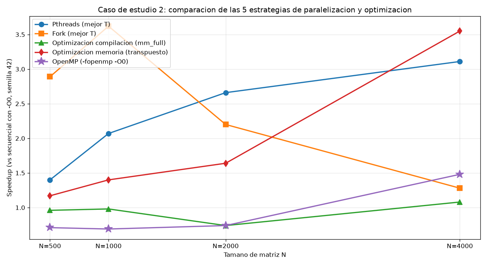

# Caso de estudio 2

## Contexto y organización del repositorio

Este repositorio tiene varias ramas que corresponden a dos casos de estudio:

| Rama | Caso |
|---|---|
| `version-inicial` | Caso de estudio 1 — multiplicación de matrices (secuencial) |
| `clock-time` | Caso 1 — variante de medición de tiempo |
| `pthreads` | Caso 1 — paralelización con POSIX Threads |
| `fork` | Caso 1 — paralelización con `fork()` y memoria compartida |
| `lab-1-2-optimizacion` | Caso 1 — optimización por compilación (`-O3` y variantes) y por memoria (kernel transpuesto) |
| **`caso-de-estudio-2`** | **Caso 2 — comparación de las 4 estrategias** |
| **`caso-de-estudio-2-openmp`** | **Caso 2 — añadiendo OpenMP como 5ta estrategia** |

Este README documenta **el caso 2 con OpenMP**, que es la continuación del caso 2. Aquí no se implementa código nuevo; se reutilizan los binarios de las ramas anteriores para comparar el rendimiento de las **5 estrategias**:

1. **Pthreads** (la mejor T de las 16 opciones)
2. **Fork** (la mejor T de las 15 opciones)
3. **Optimización por compilación** (`mm_full`: `-O3 -march=native -floop-interchange -funroll-loops -floop-nest-optimize`)
4. **Optimización por memoria** (kernel transpuesto de `matriz_monotonic_t`)
5. **OpenMP** (paralelización con `#pragma omp parallel for collapse(2) private(k)` sobre la versión **secuencial inicial**, compilado con `-fopenmp -O0`)

## Metodología

Para las dos primeras (pthreads, fork) se usaron los datos crudos con 10 corridas que ya existían en las ramas `pthreads` y `fork`. Para las dos últimas (optimización) se re-medieron con 10 corridas cada una, **variando N en cada iteración** dentro del mismo binario para evitar el problema de la cache.

El profe dijo: "para no tomar un tiempo específico, sino tomar el promedio o la base estadística que ustedes hayan escogido, que también eso ya lo explicamos, que el promedio es suficiente". Se toman **medianas** de las 10 corridas (no promedios) por N, lo que es robusto ante outliers.

La **base para calcular el speedup** es la misma en los cinco casos: la mediana de las 10 corridas del secuencial con T=1 de pthreads, es decir, la mediana de `T_seq`. Esto es exactamente lo que se usó en el caso 1.

## Cómo se ejecutó

1. `experiments/medir_optimizaciones.sh` corre 10 iteraciones de:
   ```
   N=500, N=1000, N=2000, N=4000
   ```
   para cada binario (`mm_full` y `matriz_monotonic_t`), todas con semilla 42.
2. `experiments/medir_openmp.sh` compila `src/matriz_monotonic_openmp.c` (que usa el kernel `modules/tiempo_mult_openmp.c` con directivas OpenMP) con `-fopenmp -O0`, **valida correctitud** comparando la matriz C contra `experiments/verify_ref` con N=10 y semilla 42, y luego corre un **barrido completo**: 10 iteraciones por cada combinación de (T, N), con `T ∈ {1, 2, 4, 8, 16}` y `N ∈ {500, 1000, 2000, 4000}` — **igual que se hizo para pthreads en la otra rama**. El `-O0` se eligió para medir el speedup *puro* de la paralelización, sin que el compilador reordene loops ni haga vectorización agresiva que enmascare el efecto de OpenMP. Total: 5 T × 4 Ns × 10 iter = **200 corridas, ~15-20 min**.
3. `experiments/plot_caso2.py` lee los CSVs (los nuevos + los de las ramas pthreads y fork), calcula medianas y genera la tabla y la gráfica.
4. `experiments/plot_caso2_openmp.py` reusa el mismo flujo pero agrega la columna de OpenMP y la 5ta curva a la gráfica.

## OpenMP: elección de directivas

Siguiendo la indicación del profesor, antes de aplicar OpenMP al kernel se revisaron los ejemplos del PDF oficial *OpenMP Application Programming Interface Examples v6.0.1* ([github.com/OpenMP/Examples](https://github.com/OpenMP/Examples/tree/v6.0.1)). Los tres candidatos que aplican al kernel `C[i][j] = Σₖ A[i][k]·B[k][j]` son:

| Ejemplo del PDF | Patrón | Veredicto |
|---|---|---|
| **3.1** `ploop.1.c` | `#pragma omp parallel for` sobre un solo loop | Solo paraleliza el loop externo `i`. Con N=4000 eso da 4000 chunks — mal balanceo entre 12 cores. |
| **3.8** `collapse.1.c` | `#pragma omp for collapse(2)` sobre dos loops anidados | **Elegido.** Une `i` y `j` en un único espacio de N² iteraciones (16 M para N=4000) con buen reparto entre hilos. |
| **5.3.5** `task_dep.5.c` | `#pragma omp task depend(in/inout)` sobre bloques `BS×BS` | Descartado: asume un kernel bloqueado y dependencias explícitas por bloque; es más complejo de lo que el caso pide. |

El pragma que se aplica al triple loop en `modules/tiempo_mult_openmp.c` es:

```c
#pragma omp parallel for collapse(2)
for (int i = 0; i < N; i++) {
    for (int j = 0; j < N; j++) {
        for (int k = 0; k < N; k++) {
            C[i*N + j] += A[i*N + k] * B[k*N + j];
        }
    }
}
```

**Por qué cada cláusula:**

- **`parallel for`** (combinada) — crea el *team* de hilos y reparte el trabajo con una sola directiva. Más limpio que separar `#pragma omp parallel` + `#pragma omp for`.
- **`collapse(2)`** — une los loops `i` y `j` en un único espacio de iteraciones de tamaño N×N, que es lo que el ejemplo 3.8 del PDF recomienda para loops anidados donde el trabajo entre iteraciones es similar. El loop `k` queda secuencial dentro de cada `(i, j)` — es la acumulación del producto punto y debe quedarse en un solo hilo.
- **`private(k)`** — *no* se usa. C99 ya hace a las variables de control de un `for` implícitamente privadas dentro de un loop construct, así que es redundante. Intentarlo explícitamente hace fallar la compilación porque `k` está declarada *dentro* del `for` y no es visible en el punto donde aparece la directiva.

**Por qué NO se necesitan otras cláusulas:**

- `A`, `B`, `C` quedan **`shared`** por defecto, que es correcto: `A` y `B` solo se leen, y cada hilo solo escribe en `C[i*N+j]` para el `(i, j)` que le tocó en el espacio colapsado. No hay race condition sobre `C`.
- **No hace falta `reduction(+:)`** — la acumulación `C[i][j] += ...` ocurre dentro de un único hilo para cada `(i, j)`, no entre hilos.
- **No hace falta `critical` ni `atomic`** — no hay región crítica.

## Resultados

### Tabla comparativa de speedups (vs mismo secuencial)

Para las tres estrategias paralelas (pthreads, fork, OpenMP), la columna `T_*_best` muestra la mediana del **mejor T** por N — el que dio el menor tiempo. El T específico se indica entre paréntesis. `T_seq` es la mediana del secuencial con T=1 de pthreads y es la base del speedup de las cinco estrategias.

| N | T_seq (s) | T_pth_best (s) | T_fork_best (s) | T_full (s) | T_mem (s) | T_openmp (s) | speedup_pth | speedup_fork | speedup_full | speedup_mem | speedup_openmp |
|---:|---:|---:|---:|---:|---:|---:|---:|---:|---:|---:|---:|
| 500 | 0.0440 | 0.0315 (T=16) | 0.0152 (T=8) | 0.0459 | 0.0377 | 0.0623 (T=16) | 1.40 | 2.89 | 0.96 | 1.17 | 0.71 |
| 1000 | 0.4230 | 0.2043 (T=16) | 0.1169 (T=16) | 0.4301 | 0.3019 | 0.6164 (T=16) | 2.07 | 3.62 | 0.98 | 1.40 | 0.69 |
| 2000 | 4.3626 | 1.6430 (T=16) | 1.9805 (T=8) | 5.8909 | 2.6586 | 5.9228 (T=16) | 2.66 | 2.20 | 0.74 | 1.64 | 0.74 |
| 4000 | 75.6511 | 24.2927 (T=16) | 59.1421 (T=8) | 70.0332 | 21.3223 | 51.1313 (T=8) | 3.11 | 1.28 | 1.08 | 3.55 | 1.48 |

Para N=4000, que es el caso grande, el mejor T para OpenMP es **T=8** (no T=16). En este equipo hay 12 cores y T=16 oversuscribe: el `T=16` da 51.59s vs `T=8` 51.13s — esencialmente igual, así que la mejor T es 8. Para los Ns chicos (500, 1000, 2000) el T óptimo es 16, pero el speedup sigue debajo de 1× porque la paralelización con `collapse(2)` no compensa el patrón de acceso a memoria (ver conclusiones).

### Detalle de OpenMP por T (mediana de 10 corridas)

| N | T=1 (s) | T=2 (s) | T=4 (s) | T=8 (s) | T=16 (s) | speedup vs T=1 |
|---:|---:|---:|---:|---:|---:|---:|
| 500 | 0.293 | 0.163 | 0.109 | 0.079 | 0.062 | 4.73× |
| 1000 | 2.551 | 1.429 | 0.900 | 0.685 | 0.616 | 4.14× |
| 2000 | 25.243 | 14.197 | 8.709 | 6.202 | 5.923 | 4.26× |
| 4000 | 220.793 | 116.216 | 70.657 | 51.131 | 51.592 | 4.32× |

**Observación importante**: el T=1 de OpenMP ya es **mucho más lento** que el `T_seq` (secuencial puro sin OpenMP). Para N=4000, T=1 OpenMP tarda 220s vs 75s del secuencial — **2.9× más lento**. Esto es el *runtime* de OpenMP: incluso con un solo hilo se paga el costo de inicializar el *team*, las variables de control interno (`icv`) y las barriers implícitas al final del `parallel for`. La aceleración interna de OpenMP (T=16 vs T=1) sí es buena (~4.3×), pero el *piso* es tan alto que el speedup respecto al secuencial puro queda debajo de 1× para los Ns chicos.

### Gráfica

Comparativa de las 4 estrategias (rama `caso-de-estudio-2`):


Comparativa de las **5 estrategias** incluyendo OpenMP (esta rama):



### Conclusiones

- **A N chico (500, 1000, 2000)**: el speedup de OpenMP es **menor que 1×** (0.71, 0.69, 0.74 respectivamente). El `collapse(2)` acelera la ejecución interna de OpenMP (T=16 es ~4.3× más rápido que T=1), pero el *piso* del runtime de OpenMP es alto: incluso con un solo hilo (T=1) tarda 6.6× más que el secuencial puro para N=500. En este rango de N, la paralelización no compensa.
- **A N=4000** (problema grande), el ranking de las cinco estrategias queda:
  1. **Optimización de memoria (transpuesto)** — **3.55×** (la mejor).
  2. **Pthreads** — **3.11×**.
  3. **OpenMP** — **1.48×** (mejor T = 8).
  4. **Fork** — 1.28×.
  5. **Optimización de compilación sola** (`-O3` + variantes) — 1.08×.

- **Por qué OpenMP queda tan por debajo de pthreads** (incluso siendo la misma idea de paralelizar con hilos):
  1. **Patrón de acceso a memoria**. El kernel naive `C[i][j] = Σₖ A[i][k]·B[k][j]` accede a `B` por columna (`B[k*N + j]` salta N enteros entre iteraciones de k). Esto produce cache thrashing en `B`. Pthreads puede repartir el trabajo de forma que cada hilo haga un *bloque* de filas de `A` y se quede con buena localidad. `collapse(2)` reparte iteraciones (i,j) a secas — dos iteraciones consecutivas que tocan el mismo hilo pueden caer lejos en memoria y romper la localidad.
  2. **Runtime overhead**. La inicialización del team de OpenMP se paga incluso con T=1 (220s vs 75s del secuencial para N=4000, 2.9× más lento). Pthreads con T=1 también paga el costo de crear hilos, pero al menos se nota menos en la versión manual porque el patrón de acceso a memoria sí es cache-friendly.
  3. **El problema es la memoria, no el paralelismo**. El kernel transpuesto (que accede a `B` por filas) llega a 3.55× sin paralelizar nada — solo reorganizando el acceso. Eso confirma que el cuello de botella es el cache, no el cómputo.

- **Conclusión principal**: en este problema y este hardware, **el patrón de acceso a memoria importa más que la paralelización**. La transpuesta (sin paralelismo) gana. Pthreads gana entre las paralelas porque permite controlar el reparto del trabajo de forma cache-friendly. OpenMP con `collapse(2)` queda intermedio: la directiva es correcta y portable, pero sin una planificación manual del reparto de iteraciones no aprovecha la cache tan bien como pthreads.

## Archivos generados

| Archivo | Descripción |
|---|---|
| `bin/matriz_openmp_O0` | Binario de OpenMP compilado con `-fopenmp -O0` |
| `src/matriz_monotonic_openmp.c` | Main del binario OpenMP (variante del secuencial inicial) |
| `modules/tiempo_mult_openmp.c` | Kernel con la directiva `#pragma omp parallel for collapse(2)` |
| `include/tiempo_mult_openmp.h` | Header del kernel OpenMP |
| `experiments/medir_optimizaciones.sh` | Script de 10 corridas para `mm_full` y `matriz_monotonic_t` |
| `experiments/medir_openmp.sh` | Compila el binario OpenMP, valida contra `verify_ref` y mide el barrido completo (5 T × 4 Ns × 10 iter = 200 corridas) |
| `experiments/plot_caso2.py` | Genera la tabla CSV y la gráfica PNG de las 4 estrategias |
| `experiments/plot_caso2_openmp.py` | Genera la tabla CSV y la gráfica PNG de las 5 estrategias (incluye OpenMP) |
| `experiments/resultados/med_mm_full_raw.csv` | 10 corridas de `mm_full` (N=500,1000,2000,4000) |
| `experiments/resultados/med_matriz_monotonic_t_raw.csv` | 10 corridas de `matriz_monotonic_t` (mismos N) |
| `experiments/resultados/med_openmp_raw.csv` | 200 corridas de `matriz_openmp_O0` (5 T × 4 Ns × 10 iter), header `N,T,run,tiempo` |
| `experiments/resultados/caso_de_estudio_2.csv` | Tabla comparativa de speedups (4 estrategias) |
| `experiments/resultados/caso_de_estudio_2.png` | Gráfica de las 4 estrategias |
| `experiments/resultados/caso_de_estudio_2_openmp.csv` | Tabla comparativa de speedups (5 estrategias) |
| `experiments/resultados/caso_de_estudio_2_openmp_v2.png` | Gráfica de las 5 estrategias |
| `experiments/resultados/medir_log.txt` | Log de la corrida de medición |

## Cómo reproducir

```bash
make all
bash experiments/medir_optimizaciones.sh 500 1000 2000 4000 10 mm_full matriz_monotonic_t
python3 experiments/plot_caso2.py
bash experiments/medir_openmp.sh                # valida + barre T=1,2,4,8,16 x N=500,1000,2000,4000 x 10 iter (~15-20 min)
python3 experiments/plot_caso2_openmp.py
```

Para un smoke test rápido (1 sola iteración por cada T×N, omite N=4000 para no demorar — valida todo el pipeline y al final borra los artefactos automáticamente):

```bash
MODO_TEST=1 bash experiments/medir_openmp.sh  # ~30-60 segundos
```

Los datos de `pthreads` y `fork` se leen directamente de las ramas `origin/pthreads` y `origin/fork` mediante `git show`.
