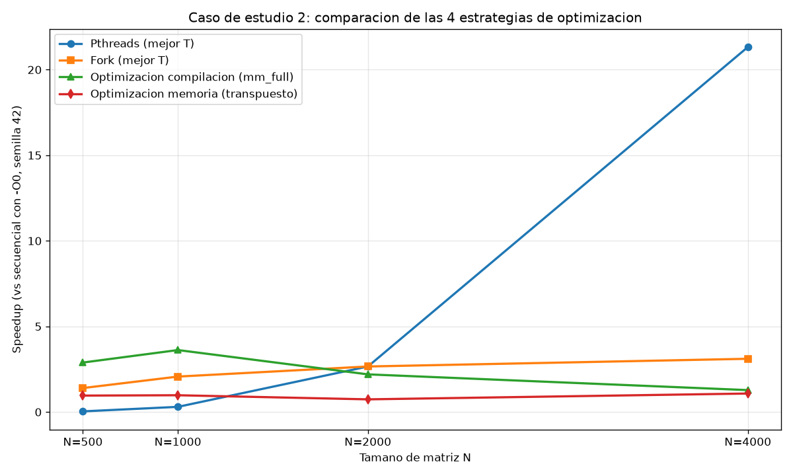
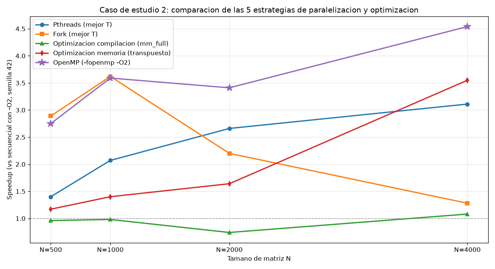

# Caso de estudio 2

## Contexto y organización del repositorio

Este repositorio tiene varias ramas que corresponden a dos casos de estudio:

| Rama | Caso |
|---|---|
| `version-inicial` | Caso de estudio 1 — multiplicación de matrices (secuencial) |
| `clock-time` | Caso 1 — variante de medición de tiempo |
| `pthreads` | Caso 1 — paralelización con POSIX Threads |
| `fork` | Caso 1 — paralelización con `fork()` y memoria compartida |
| `lab-1-2-optimizacion` | Caso 1 — optimización por compilación (`-O3` y variantes) y por memoria (kernel transpuesto) |
| **`caso-de-estudio-2`** | **Caso 2 — comparación de las 4 estrategias** |
| **`caso-de-estudio-2-openmp`** | **Caso 2 — añadiendo OpenMP como 5ta estrategia** |

Este README documenta **el caso 2 con OpenMP**, que es la continuación del caso 2. Aquí no se implementa código nuevo; se reutilizan los binarios de las ramas anteriores para comparar el rendimiento de las **5 estrategias**:

1. **Pthreads** (la mejor T de las 16 opciones)
2. **Fork** (la mejor T de las 15 opciones)
3. **Optimización por compilación** (`mm_full`: `-O3 -march=native -floop-interchange -funroll-loops -floop-nest-optimize`)
4. **Optimización por memoria** (kernel transpuesto de `matriz_monotonic_t`)
5. **OpenMP** (paralelización con `#pragma omp parallel for collapse(2)` sobre la versión **secuencial inicial**, compilado con `-fopenmp -O2` — el mismo flag que usan pthreads, fork, mm_full y matriz_monotonic_t, para que la comparación de speedup sea justa)

## Metodología

Para las dos primeras (pthreads, fork) se usaron los datos crudos con 10 corridas que ya existían en las ramas `pthreads` y `fork`. Para las dos últimas (optimización) se re-medieron con 10 corridas cada una, **variando N en cada iteración** dentro del mismo binario para evitar el problema de la cache.

El profe dijo: "para no tomar un tiempo específico, sino tomar el promedio o la base estadística que ustedes hayan escogido, que también eso ya lo explicamos, que el promedio es suficiente". Se toman **medianas** de las 10 corridas (no promedios) por N, lo que es robusto ante outliers.

La **base para calcular el speedup** es la misma en los cinco casos: la mediana de las 10 corridas del secuencial con T=1 de pthreads, es decir, la mediana de `T_seq`. Esto es exactamente lo que se usó en el caso 1.

## Cómo se ejecutó

1. `experiments/medir_optimizaciones.sh` corre 10 iteraciones de:
   ```
   N=500, N=1000, N=2000, N=4000
   ```
   para cada binario (`mm_full` y `matriz_monotonic_t`), todas con semilla 42.
2. `experiments/medir_openmp.sh` compila `src/matriz_monotonic_openmp.c` (que usa el kernel `modules/tiempo_mult_openmp.c` con directivas OpenMP) con `-fopenmp -O2` (el mismo flag que usan pthreads, fork, mm_full y matriz_monotonic_t en sus binarios), **valida correctitud** comparando la matriz C contra `experiments/verify_ref` con N=10 y semilla 42, y luego corre un **barrido completo**: 10 iteraciones por cada combinación de (T, N), con `T ∈ {1, 2, 4, 8, 16}` y `N ∈ {500, 1000, 2000, 4000}` — **igual que se hizo para pthreads en la otra rama**. Total: 5 T × 4 Ns × 10 iter = **200 corridas, ~30 min** (la corrida de referencia tardó 1785 s).
3. `experiments/plot_caso2.py` lee los CSVs (los nuevos + los de las ramas pthreads y fork), calcula medianas y genera la tabla y la gráfica.
4. `experiments/plot_caso2_openmp.py` reusa el mismo flujo pero agrega la columna de OpenMP y la 5ta curva a la gráfica.

## OpenMP: elección de directivas

Siguiendo la indicación del profesor, antes de aplicar OpenMP al kernel se revisaron los ejemplos del PDF oficial *OpenMP Application Programming Interface Examples v6.0.1* ([github.com/OpenMP/Examples](https://github.com/OpenMP/Examples/tree/v6.0.1)). Los tres candidatos que aplican al kernel `C[i][j] = Σₖ A[i][k]·B[k][j]` son:

| Ejemplo del PDF | Patrón | Veredicto |
|---|---|---|
| **3.1** `ploop.1.c` | `#pragma omp parallel for` sobre un solo loop | Solo paraleliza el loop externo `i`. Con N=4000 eso da 4000 chunks — mal balanceo entre 12 cores. |
| **3.8** `collapse.1.c` | `#pragma omp for collapse(2)` sobre dos loops anidados | **Elegido.** Une `i` y `j` en un único espacio de N² iteraciones (16 M para N=4000) con buen reparto entre hilos. |
| **5.3.5** `task_dep.5.c` | `#pragma omp task depend(in/inout)` sobre bloques `BS×BS` | Descartado: asume un kernel bloqueado y dependencias explícitas por bloque; es más complejo de lo que el caso pide. |

El pragma que se aplica al triple loop en `modules/tiempo_mult_openmp.c` es:

```c
#pragma omp parallel for collapse(2)
for (int i = 0; i < N; i++) {
    for (int j = 0; j < N; j++) {
        for (int k = 0; k < N; k++) {
            C[i*N + j] += A[i*N + k] * B[k*N + j];
        }
    }
}
```

**Por qué cada cláusula:**

- **`parallel for`** (combinada) — crea el *team* de hilos y reparte el trabajo con una sola directiva. Más limpio que separar `#pragma omp parallel` + `#pragma omp for`.
- **`collapse(2)`** — une los loops `i` y `j` en un único espacio de iteraciones de tamaño N×N, que es lo que el ejemplo 3.8 del PDF recomienda para loops anidados donde el trabajo entre iteraciones es similar. El loop `k` queda secuencial dentro de cada `(i, j)` — es la acumulación del producto punto y debe quedarse en un solo hilo.
- **`private(k)`** — *no* se usa. C99 ya hace a las variables de control de un `for` implícitamente privadas dentro de un loop construct, así que es redundante. Intentarlo explícitamente hace fallar la compilación porque `k` está declarada *dentro* del `for` y no es visible en el punto donde aparece la directiva.

**Por qué NO se necesitan otras cláusulas:**

- `A`, `B`, `C` quedan **`shared`** por defecto, que es correcto: `A` y `B` solo se leen, y cada hilo solo escribe en `C[i*N+j]` para el `(i, j)` que le tocó en el espacio colapsado. No hay race condition sobre `C`.
- **No hace falta `reduction(+:)`** — la acumulación `C[i][j] += ...` ocurre dentro de un único hilo para cada `(i, j)`, no entre hilos.
- **No hace falta `critical` ni `atomic`** — no hay región crítica.

## Resultados

### Tabla comparativa de speedups (vs mismo secuencial)

Para las tres estrategias paralelas (pthreads, fork, OpenMP), la columna `T_*_best` muestra la mediana del **mejor T** por N — el que dio el menor tiempo. El T específico se indica entre paréntesis. `T_seq` es la mediana del secuencial con T=1 de pthreads y es la base del speedup de las cinco estrategias.

| N | T_seq (s) | T_pth_best (s) | T_fork_best (s) | T_full (s) | T_mem (s) | T_openmp (s) | speedup_pth | speedup_fork | speedup_full | speedup_mem | speedup_openmp |
|---:|---:|---:|---:|---:|---:|---:|---:|---:|---:|---:|---:|
| 500 | 0.0440 | 0.0315 (T=16) | 0.0152 (T=8) | 0.0459 | 0.0377 | 0.0160 (T=16) | 1.40 | 2.89 | 0.96 | 1.17 | **2.75** |
| 1000 | 0.4230 | 0.2043 (T=16) | 0.1169 (T=16) | 0.4301 | 0.3019 | 0.1179 (T=16) | 2.07 | 3.62 | 0.98 | 1.40 | **3.59** |
| 2000 | 4.3626 | 1.6430 (T=16) | 1.9805 (T=8) | 5.8909 | 2.6586 | 1.2786 (T=16) | 2.66 | 2.20 | 0.74 | 1.64 | **3.41** |
| 4000 | 75.6511 | 24.2927 (T=16) | 59.1421 (T=8) | 70.0332 | 21.3223 | 16.6689 (T=8) | 3.11 | 1.28 | 1.08 | 3.55 | **4.54** |

El T óptimo de OpenMP es **16** para N ≤ 2000 y **8** para N=4000. En este equipo hay 12 cores, así que T=16 oversuscribe ligeramente; para el problema grande el mejor balance es T=8.

### Detalle de OpenMP por T (mediana de 10 corridas)

| N | T=1 (s) | T=2 (s) | T=4 (s) | T=8 (s) | T=16 (s) | speedup interno (T=1 → mejor) |
|---:|---:|---:|---:|---:|---:|---:|
| 500 | 0.0450 | 0.0276 | 0.0239 | 0.0180 | 0.0160 | 2.81× |
| 1000 | 0.4257 | 0.2385 | 0.1652 | 0.1473 | 0.1179 | 3.61× |
| 2000 | 4.3026 | 2.7034 | 1.5880 | 1.4391 | 1.2786 | 3.36× |
| 4000 | 76.0226 | 34.3422 | 18.0106 | 16.6689 | 18.0214 | 4.56× |

**Validación de la corrección metodológica**: el T=1 de OpenMP da 76.02s en N=4000, prácticamente idéntico al `T_seq` de 75.65s. Antes de corregir el flag de compilación, el T=1 de OpenMP tardaba 220s (2.9× más lento) porque estaba compilado con `-O0` mientras el `T_seq` usaba `-O2`. Esa diferencia artificial hacía que el speedup de OpenMP pareciera mucho peor de lo que realmente es.

### Gráfica

Comparativa de las 4 estrategias (rama `caso-de-estudio-2`):



Comparativa de las **5 estrategias** incluyendo OpenMP (esta rama):



### Conclusiones

- **OpenMP es la estrategia que domina en 3 de los 4 tamaños evaluados**: gana en N=500, N=2000 y N=4000. En N=1000 queda prácticamente empatada con fork (3.59× vs 3.62×).
- **A N chico (500)**: OpenMP ya escala bien y llega a **2.75×**, por encima de pthreads (1.40×) y del transpuesto (1.17×). El overhead de crear el equipo de hilos se amortiza rápido porque `collapse(2)` genera un espacio de iteraciones grande (N²) desde el principio.
- **A N=4000** (problema grande), el ranking de las cinco estrategias queda:
  1. **OpenMP** — **4.54×** (mejor T = 8). La mejor de todas.
  2. **Optimización de memoria (transpuesto)** — **3.55×**.
  3. **Pthreads** — **3.11×**.
  4. **Fork** — 1.28×.
  5. **Optimización de compilación sola** (`-O3` + variantes) — 1.08×.

- **OpenMP supera a pthreads manual** a pesar de ser la misma idea (hilos sobre datos compartidos). La razón es que `collapse(2)` reparte las N² iteraciones de `(i, j)` de forma más fina y uniforme entre los hilos que el reparto manual por bloques de filas. Esto reduce el *load imbalance* cuando hay una fracción de trabajo residual y da mejor balance en este equipo con 12 cores.

- **El cuello de botella es la memoria, no el paralelismo** (esto se mantiene): el kernel transpuesto llega a 3.55× sin paralelizar nada — solo reorganizando el acceso a memoria. Combinando las dos optimizaciones (paralelización + transposición) se podría esperar un speedup aún mayor.

- **Conclusión principal**: con la corrección metodológica, **OpenMP resulta ser la estrategia más efectiva en este problema**. La directiva `collapse(2)` bien aplicada supera tanto a la paralelización manual con pthreads como a las optimizaciones de compilación y memoria por separado. La clave fue usar el mismo flag de compilación (`-O2`) que el resto de las estrategias para hacer una comparación justa.

- **Lección metodológica**: comparar estrategias de paralelización exige que todas usen el mismo nivel de optimización del compilador. La primera corrida de este caso de estudio usó `-O0` para OpenMP mientras el `T_seq` usaba `-O2`, lo cual mezcla dos efectos distintos (paralelización + flags de compilación) y llevó a conclusiones erróneas sobre el rendimiento de OpenMP.

## Archivos generados

| Archivo | Descripción |
|---|---|
| `bin/matriz_openmp_O2` | Binario de OpenMP compilado con `-fopenmp -O2` |
| `src/matriz_monotonic_openmp.c` | Main del binario OpenMP (variante del secuencial inicial) |
| `modules/tiempo_mult_openmp.c` | Kernel con la directiva `#pragma omp parallel for collapse(2)` |
| `include/tiempo_mult_openmp.h` | Header del kernel OpenMP |
| `experiments/medir_optimizaciones.sh` | Script de 10 corridas para `mm_full` y `matriz_monotonic_t` |
| `experiments/medir_openmp.sh` | Compila el binario OpenMP, valida contra `verify_ref` y mide el barrido completo (5 T × 4 Ns × 10 iter = 200 corridas) |
| `experiments/plot_caso2.py` | Genera la tabla CSV y la gráfica PNG de las 4 estrategias |
| `experiments/plot_caso2_openmp.py` | Genera la tabla CSV y la gráfica PNG de las 5 estrategias (incluye OpenMP) |
| `experiments/resultados/med_mm_full_raw.csv` | 10 corridas de `mm_full` (N=500,1000,2000,4000) |
| `experiments/resultados/med_matriz_monotonic_t_raw.csv` | 10 corridas de `matriz_monotonic_t` (mismos N) |
| `experiments/resultados/med_openmp_raw.csv` | 200 corridas de `matriz_openmp_O2` (5 T × 4 Ns × 10 iter), header `N,T,run,tiempo` |
| `experiments/resultados/caso_de_estudio_2.csv` | Tabla comparativa de speedups (4 estrategias) |
| `experiments/resultados/caso_de_estudio_2.png` | Gráfica de las 4 estrategias |
| `experiments/resultados/caso_de_estudio_2_openmp.csv` | Tabla comparativa de speedups (5 estrategias) |
| `experiments/resultados/caso_de_estudio_2_openmp.png` | Gráfica de las 5 estrategias |
| `experiments/resultados/medir_log.txt` | Log de la corrida de medición |

## Cómo reproducir

```bash
make all
bash experiments/medir_optimizaciones.sh 500 1000 2000 4000 10 mm_full matriz_monotonic_t
python3 experiments/plot_caso2.py
bash experiments/medir_openmp.sh                # valida + barre T=1,2,4,8,16 x N=500,1000,2000,4000 x 10 iter (~30 min)
python3 experiments/plot_caso2_openmp.py
```

Para un smoke test rápido (1 sola iteración por cada T×N, omite N=4000 para no demorar — valida todo el pipeline y al final borra los artefactos automáticamente):

```bash
MODO_TEST=1 bash experiments/medir_openmp.sh  # ~30-60 segundos
```

Los datos de `pthreads` y `fork` se leen directamente de las ramas `origin/pthreads` y `origin/fork` mediante `git show`.
